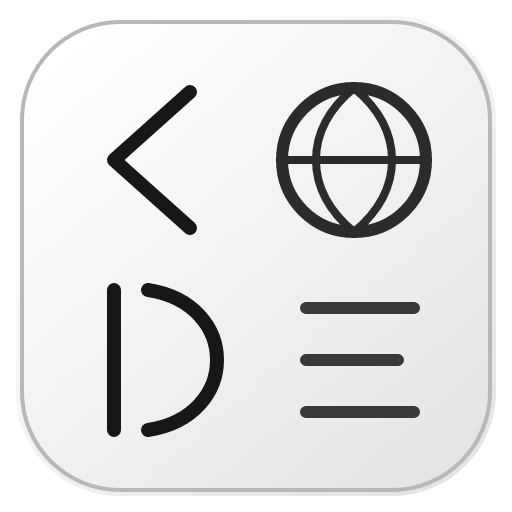

<div align="center">
  
  <h1>OpenWebCode</h1>
  <p><strong>A self-hosted AI coding workbench that opens in your browser</strong></p>
  <p>
    <a href="https://github.com/snnh/openwebcode/releases"></a>
    <a href="./LICENSE"></a>
    
    
  </p>
  <p>
    English | <a href="./README.md">简体中文</a>
  </p>
  <p>
    <a href="#quick-start">Quick start</a> ·
    <a href="#core-features">Core features</a> ·
    <a href="#permissions-sandboxing-and-security-boundaries">Security &amp; sandbox</a> ·
    <a href="#snapshots-and-managed-workspaces">Snapshot rollback</a> ·
    <a href="#headless-cli">Headless CLI</a> ·
    <a href="#documentation">Documentation</a>
  </p>
</div>

OpenWebCode is an AI coding workbench that runs on your own machine. The agent loop, permission decisions, context ledger, session persistence, and snapshot orchestration all run on the local server; the browser is only the client — **closing the tab or reconnecting after a network drop does not interrupt a running task**.

It is built for real repositories: file reads and writes, a persistent terminal, tests and diagnostics, Git workflows, symbol indexing, system-level sandbox isolation, and one-click snapshot rollback. You can also check long-running task progress and approve permissions from a phone or another computer. Model endpoints, keys, and data remain entirely under your control, with no lock-in to a model vendor.

## Why OpenWebCode

- **Server-resident, cross-device takeover**: tasks run on the local server; connect from a desktop or phone browser (PWA) at any time, with incremental event replay after disconnects and remote permission approval.
- **Engineering-grade isolation and rollback**: built-in system-level sandboxes (Windows AppContainer / Linux bubblewrap) and filesystem snapshots (btrfs / ZFS / overlayfs / ReFS / VHDX / qcow2 / git-shadow) make it safe to let the agent change code.
- **Bring your own keys, native multi-protocol support**: native support for Anthropic Messages, OpenAI Chat Completions, OpenAI Responses, and Google Gemini `generateContent`, with hot model switching, fallback chains, and role-based routing.
- **Careful context and cost governance**: a live context ledger, bounded tool output that can be recalled on demand, automatic summary compaction, cache-hit tracking, and USD/CNY cost reporting.
- **Lightweight, high-performance three-tier architecture**: a native C11 executor + Node.js service layer + React frontend; 5,000-message long sessions respond in milliseconds, and the Headless CLI (`owc run`) supports CI and automation.

## Architecture

```text
Browser web/ (React 19 + Vite 6)
        │ HTTP / WebSocket
        ▼
server/ (Node.js 24 + Fastify, default :3210)
        │ JSON-RPC 2.0 / stdio
        ▼
core/ (C11 executable owc-exec)
```

| Layer | Responsibility |
|---|---|
| **`core/`** | Pure low-level executor: commands, file primitives, PTY, path policy, sandboxing, and overlay. It does not implement HTTP or LLM logic and never sees API keys or prompts. |
| **`server/`** | Agent loop, tool scheduling, permission chain, context ledger and compaction, multi-provider adapters, JSONL session persistence, snapshot orchestration, extension host, MCP, SCM, index, and diagnostics. |
| **`web/`** | The only interactive UI (no TUI), with a bilingual Chinese/English interface; static assets are served by the server. The **Headless CLI** (`owc run`) reuses the same server API. |

---

## Quick start

### Windows (x86-64)

1. Go to [Releases](https://github.com/snnh/openwebcode/releases), download `openwebcode-<version>-windows-x64.msi`, and install it (administrator rights required).
2. Open a new terminal and run `owc` (or run `bin\owc.cmd` from the install directory).
3. Open <http://127.0.0.1:3210> in a browser.

### Linux (x86-64 / arm64 / loongarch64)

One-line online installation (the script selects the architecture package from `uname -m`):

```sh
curl -fsSL https://raw.githubusercontent.com/snnh/openwebcode/main/packaging/install-online.sh | bash
```

Alternatively, download the `tar.gz` for your architecture, extract it, and run `./install.sh` (add `--yes` in a script or CI environment to skip interactive prompts). For LAN access, systemd services, or firewall configuration, see [`packaging/README.en.md`](./packaging/README.en.md).

### Docker (Linux host, amd64 / arm64)

The image is hosted on GHCR and includes `core`, Node 24.22.1, bubblewrap, Git, Python 3, and a health check:

```sh
# Option 1: use the docker-compose.yml at the repository root (recommended)
docker compose up -d
docker compose logs | grep 访问链接
```

```sh
# Option 2: run the container directly
docker run -d --name openwebcode --restart unless-stopped \
  -p 3210:3210 -v openwebcode-data:/data \
  ghcr.io/snnh/openwebcode:latest
docker logs openwebcode | grep 访问链接
```

The container listens on `0.0.0.0` and generates an access token on first start. Open the `http://<host-ip>:3210/?token=<token>` link from the logs.

> [!NOTE]
> - **Data and workspace**: persistent data is stored in the `openwebcode-data` volume by default. You can mount a host code directory at `/workspace`; `OWC_WORKSPACE` in compose fixes the top-level ownership at startup.
> - **Container sandbox**: the default `bubblewrap` mode requires the host to allow unprivileged user namespaces and mount operations (a common compose allowance is `seccomp=unconfined`). If the host is restricted, switch explicitly to `landlock` or turn the sandbox off.
> - **Building your own image**: run `docker build -t openwebcode .`, or uncomment `build:` in `docker-compose.yml`.

### First run: three steps

1. **Configure a model**: open **Settings → Model Catalog**, add and enable a provider (Anthropic / OpenAI / Gemini / DeepSeek / OpenRouter / Ollama, etc.), and fetch or manually add models.
2. **Create a session**: click **+** in the sidebar and choose the working directory, model, sandbox mode, and permission mode.
3. **Start collaborating**: describe the task in the composer and send it. For the first run, use a small task to verify model connectivity, approval cards, and sandbox behavior.

---

## Supported platforms

| Form | Architectures | Distribution | Default sandbox |
|---|---|---|---|
| **Windows 10/11** | x86-64 | MSI installer | AppContainer (Job Object / Windows Sandbox / off can be selected) |
| **Linux** | x86-64 / arm64 / loongarch64 | `tar.gz` / online script | bubblewrap (Landlock / off can be selected) |
| **Docker (Linux)** | amd64 / arm64 | `ghcr.io/snnh/openwebcode` | bubblewrap (depends on host support; Landlock / off can be selected) |
| **Browser** | Any | Chrome/Edge ≥ 111, Firefox ≥ 113 (phones/tablets supported) | — |

<details>
<summary>Platform compatibility details and minimum hardware guidance</summary>

- **Linux glibc**: prebuilt `tar.gz` packages are built on Ubuntu 24.04 and require **glibc ≥ 2.38**; the Docker image is based on Debian 13 (glibc 2.41). For older glibc, build from source.
- **Kernel and sandbox dependencies**: the default `bubblewrap` mode **fails closed** with a clear error when `bwrap` is missing or unprivileged user namespaces are restricted; it does not silently degrade. `landlock` requires kernel ≥ 5.13, and network denial requires ABI 4 (roughly 6.7+, TCP only).
- **Special architectures**: Windows does not currently ship a native ARM64 package; the Loongson `loongarch64` package does not bundle Node.js and requires system Node.js ≥ 24.22.1. **HarmonyOS** is developed in a separate repository and is not part of the current release matrix.
- **Hardware guidance**: dual-core 2.0 GHz CPU, ≥ 512 MiB free memory (1 GiB recommended), and ≥ 500 MiB free disk. Very large repositories (100k-file index) or managed workspaces need more headroom.

</details>

---

## Core features

### 1. Coding agent and workflow

- **Real workspace operations**: built-in `bash`, `read_file`, `write_file`, `edit_file`, `glob`, `grep`, `read_media`, `read_artifact`, and more, strictly respecting workspace root boundaries and no-follow/reparse path protections.
- **Persistent shell and environment switching**: each session normally reuses one PTY shell (preserving `cd` and environment variables across calls; background jobs support output polling and termination, with automatic fallback when PTY is unavailable). The session header can switch Python (host / uv workspace / uv config directory) and Node (global / project / fnm / nvm) environments, mounting the selected toolchain read-only inside the sandbox.
- **Code index and test loop**: `repo_map` / `code_search` provide repository structure and symbol search; `test_runner` recognizes vitest/jest, pytest, go test, and dotnet test, and sends structured failures to the Problems panel.
- **Git and SCM panel**: `git_status` / `git_diff` / `git_commit` plus the full worktree lifecycle; the SCM panel provides visual diffs, staging, discarding changes, and generated commit messages.
- **Three execution modes + Swarm**:
  - `code`: direct read/write/execute;
  - `plan`: strictly read-only investigation with a plan that requires human approval before execution;
  - `goal`: self-evaluates completion each turn and can continue automatically for up to 10 rounds;
  - `Swarm` (independent switch, combinable with any mode): multi-member collaboration with a shared discussion board, per-member live views, and optional synthesis.
- **Sub-agents, task list, and structured interaction**: built-in `explore` (read-only), `general` (write-capable), and custom sub-agents, dispatched in parallel with isolated contexts; `todo_write` persists multi-step progress; `ask_user` supports confirmation, single/multi-select, and free text, pausing for human feedback before continuing.

### 2. Models, providers, and web access

- **Native support for four protocols**: Anthropic Messages, OpenAI Chat Completions, OpenAI Responses, and Google Gemini native `generateContent` (streaming SSE, thinking configuration, `thoughtSignature` / `functionCall.id` replay in original order, and `inlineData` media results).
- **Flexible routing and resilience**:
  - **Hot switching**: change the model and thinking level while running without interrupting the in-flight request; effective on the next turn.
  - **Fallback chain**: configure up to 3 fallback models. After the primary model exhausts retries on rate limits, overload, timeouts, or stream failures, the next model continues automatically (authentication and request-shape errors do not switch).
  - **Role routing**: configure a dedicated fast model (compaction, titles, translation, and other side tasks) and four sub-agent model roles (premium / balanced / fast / cheap).
- **Agent presets**: switch between **classic** (default, zero overrides), **minimal** (OWC's own trimmed prompt + tool allowlist), **mimicry** (Claude Code / Kimi Code / ZCode / Codex / DSH Minimal), and **custom** presets, with a global default and per-session override; tool implementations and the permission chain stay unchanged.
- **14 web search and fetch providers**: `web_search` / `web_fetch` support Jina, Brave, Tavily, Bing, Baidu AI Search (Qianfan), SearXNG, Exa, LinkUp, Bocha, Firecrawl, ScrapingBee, ScraperAPI, ZenRows, and Custom, with independent Search/Fetch configuration. OpenAI Responses additionally supports provider-side built-in search.

> [!NOTE]
> **Protocol boundaries**: `deferLoading` is effective only for Anthropic Messages; Gemini native does not map built-in Google Search and does not use explicit prompt-cache breakpoints. Provider-side model search is supported only by OpenAI Responses.

### 3. Context governance and cost transparency

- **Unified context ledger**: live window usage, per-segment token attribution, cache hit rate, and USD/CNY cost reports by provider/model (daily/session views and a customizable pricing catalog).
- **Automatic and manual compaction**: configurable trigger threshold (50–100%, default 85%), a structured summary validated for format and generated by the fast model (default budget 65,536 tokens; falls back to rule-based truncation on failure), plus on-demand `/compact`, `/compact tools`, or `/clear`.
- **Bounded tool results**: oversized output is truncated and stored as an artifact pointer; the agent can recall it with `read_artifact`, preventing huge diffs or logs from blowing up the context.
- **Official context extensions**: `context-saver` (rolling eviction, per-item pin/exclude/restore) and `attention-optimizer` (constraint anchoring) are enabled by default; `compact-vault` (full archive before compaction with key-based recall) is optional.

### 4. Session management, Chat mode, and automation

- **Branching session tree**: edit-and-resend, regenerate, or fork any message; historical branches remain in JSONL and can be revisited at any time.
- **Organization and export**: manual groups, pinning, archiving (releases index and watcher memory while keeping history and snapshots), multi-select batch operations, and export as self-contained read-only HTML, Markdown, or JSONL.
- **Chat mode (off by default)**: a separate ChatGPT-style interface with assistant presets, LaTeX, image attachments, optional tools (web, image generation, Python sandbox, file reads/writes), and password-protected read-only share links. Its data lives in `<data directory>/chat-sessions/`; it shares model and web configuration with the workbench, while sessions and permission state remain isolated.
- **Local sessions**: create one from the sidebar terminal icon to manage local files and processes directly as the server identity (sandbox off by default; access outside HOME requires manual approval; enabling a local sandbox narrows write roots to HOME, except WSB).
- **Modern workbench experience**: five-region layout, command palette, Quick Open, customizable shortcuts, on-demand Monaco editor and xterm terminal; bilingual Chinese/English UI, light/dark themes, and a mobile PWA (no offline cache).
- **Scheduled tasks (Cron)**: manage standard five-field cron jobs in-session with `cron_create` / `cron_list` / `cron_delete`; persisted in `cron.json` and restored after restart (multiple missed triggers during downtime collapse into one; recurring jobs fire one last time after 7 days and are then removed, while one-shot jobs are removed after firing).

---

## Composer shortcuts

| Input | Action |
|---|---|
| Plain text | Send a task description to the agent (messages sent while running enter the steering queue and are injected on the next turn) |
| `/skill-name` | Invoke a skill |
| `/custom-command` | Trigger a template from `.owc/commands/` or global commands |
| `/compact` | Overview-compact the current context; `/compact tools` performs rule-based compaction |
| `/clear` | Clear the current model context view (**full history is retained** and can be restored at any time) |
| `/init` | Analyze the workspace and generate/update the root `AGENTS.md` (writes go through the permission chain) |
| `/help` | Open **Settings → Shortcuts** |
| `@path` | Reference a workspace file and inject it into the message (completion supported; large files are truncated into artifacts) |
| `!command` | Shell shortcut sharing the same permission chain and sandbox as the `bash` tool |

> Draft auto-recovery, history recall, and image/PDF-only messages are supported (counts, sizes, and model multimodal capability are validated by both the UI and server).

---

## Permissions, sandboxing, and security boundaries

### Permission modes

New sessions default to `review` (existing sessions without a mode fall back to `ask`). The mode can be hot-switched while running, and pending approval cards settle immediately:

| Mode | Behavior |
|---|---|
| **`ask`** | Every write operation and command requires individual human confirmation |
| **`acceptEdits`** | File edits are auto-approved; commands such as `bash` still require human confirmation |
| **`review`** (default) | Reads, file edits, and internal tools are auto-approved; `bash` / `test_runner` are routed through machine rules, review model, or human tiers; MCP and extension tools default to human confirmation |
| **`yolo`** | Everything is auto-approved (risk confirmation is required when entering this mode), **but sandbox isolation still applies** |

> [!IMPORTANT]
> Even in `yolo` mode, **`git_commit` still requires human confirmation by default**, and **plan approval in `plan` mode is never skipped**. Only configure “always allow” rules for highly trusted operations.

### Sandbox matrix

| Platform | Mode | Isolation and notes |
|---|---|---|
| **Windows** | `appcontainer` (default) | Real filesystem and network isolation; supports `allow` / `deny` / `filtered` (sidecar proxy); missing deny paths inside write roots are pre-created by the host as restricted placeholders to prevent bypass |
| **Windows** | `jobobject` | Compatibility fallback: resource limits only, with no file/network isolation (network status is reported honestly as partial) |
| **Windows** | `wsb` | Windows Sandbox (one VM per session), requires the Windows feature, destroyed on close; `deny` disables VM networking |
| **Linux** | `bubblewrap` (default) | Mount/net namespace isolation; fails closed when the environment is not supported, with no silent downgrade |
| **Linux** | `landlock` | Explicit compatibility tier (kernel rules); **`denyPaths` are not enforced for commands**, and network denial covers TCP only and requires ABI 4 |
| **All platforms** | `off` | Sandbox completely disabled (not recommended) |

*Windows 11 24H2+ additionally supports **Bind Link**, mapping directories outside the workspace into the session at a virtual path (requires administrator rights; not supported in WSB).*

### Default security boundaries

- **High-risk files are denied by default**: `.env`, `.owc/hooks.json`, and `.owc/mcp.json` in the workspace are included in `denyPaths` by default, preventing the agent from escaping the sandbox by rewriting credentials or host configuration.
- **Project-level executable configuration is untrusted by default**: `.owc/hooks.json` and `.owc/mcp.json` are disabled by default (`trustProjectExecConfig=false`). Keep the default when cloning external repositories.
- **Minimal Git credential mounting**: inside the sandbox, only existing `~/.gitconfig` and `~/.config/git/config|ignore|attributes` are mounted read-only by default; `.git-credentials`, `~/.config/gh`, and `~/.ssh` are not mounted unless explicitly enabled in the session.
- **Remote access authentication**: off-loopback listening enforces an access token (≥ 32 characters), with optional TOTP global login and an allowed-origin whitelist. OWC does not terminate TLS itself; for public or cross-network deployments, put it behind an HTTPS reverse proxy.

> [!WARNING]
> 1. **The remote terminal is not sandboxed**: it runs directly on the host as the server identity, **outside the sandbox** (TOTP must be enabled and the listen address explicitly configured). It is a completely different channel from the composer’s `!` command.
> 2. **Keys are stored in plaintext locally**: API keys are stored in `<data directory>/provider-profiles.json` (POSIX permissions `0600`; the UI masks them). Treat the entire data directory as sensitive, and never commit it to Git or bake it into a public image.

---

## Snapshots and managed workspaces

Default `auto` mode creates a checkpoint before each user message (switchable to `manual`). Supports **full rollback** (truncate messages and restore files) or **file-only rollback**.

- **Automatic backend probe chain**: Linux probes `btrfs → ZFS → overlayfs → git-shadow`; Windows probes `ReFS → git-shadow`; unavailable backends prompt and fall back automatically.
- **Managed workspaces**: VHDX (Windows) and qcow2 (Linux) differential disk chains for frequent experimentation and branch work; in `overlayfs` managed mode the source directory stays read-only, changes accumulate in the upper layer, and “sync to source” writes them back after confirmation.

| Backend | Platform | Mechanism |
|---|---|---|
| `btrfs` | Linux | Read-only subvolume snapshots; restore replaces the subvolume |
| `zfs` | Linux | Dataset snapshots; restore copies data back (does not destroy newer snapshots) |
| `overlayfs` | Linux | Kernel overlayfs or fuse-overlayfs; changes accumulate in the upper layer and checkpoints are linear copies |
| `refs` | Windows | ReFS block cloning, with automatic fallback to a regular copy on failure |
| `git-shadow` | All | Git shadow repository with a linear-copy fallback (requires Git ≥ 2.25) |
| `vhdx` | Windows | Managed workspace differential chain (requires Hyper-V capabilities) |
| `qcow2` | Linux | Managed workspace differential chain (requires `qemu-img` / `qemu-nbd` and passwordless sudo) |

<details>
<summary>Snapshot and rollback boundaries</summary>

- **Terminal state**: every backend requires the session terminal to be closed before rollback; `overlayfs` and managed image disks also require it when creating checkpoints.
- **Version and limits**: `git-shadow` depends on `--pathspec-from-file` and requires Git ≥ 2.25; managed VHDX/qcow2 keeps at most 32 checkpoints and does not support deleting individual checkpoints; create a new session after reaching the limit.
- **overlayfs permissions and backup**: kernel overlayfs is preferred (requires root / `CAP_SYS_ADMIN`), otherwise it falls back to `fuse-overlayfs`; the current upper layer is copied as a backup before rollback.
- **Exclusions and protection**: a full rollback preserves the current contents of `denyPaths` (deny files missing before rollback are not resurrected from an old snapshot); `contextExcludes` applies only to checkpoints created afterwards.
- **Not applicable**: **local sessions** do not support snapshots or managed workspaces.

</details>

---

## Extensions and MCP

### Official extensions (can be toggled anytime in **Settings → Extensions**)

| Extension | Default | Description |
|---|---|---|
| `context-saver` | on | Rolling eviction, context-entry panel, pin/exclude, and artifact recovery |
| `attention-optimizer` | on | Anchors critical constraints in a context anchor region to mitigate lost-in-the-middle |
| `pdf-to-image` | on | Converts PDF pages into image attachments for multimodal models |
| `agent-presets` | on | Classic / minimal / mimicry / custom prompt and tool-shape presets |
| `content-lens` | off | Message translation and selected-text explanation that stay outside model context |
| `compact-vault` | off | Archives the full context before compaction, with key-based recall by the main model |
| `vision-tools` | off | Uses a separate vision model to describe images or exposes `describe_image` when the main model lacks vision |
| `dsh-sync` | off | Two-way sync of model configuration and sessions with a dsh data directory (writes only `apiKeyEnv` references, no plaintext keys, never overwrites existing sessions; Gemini native configuration is not synced yet) |
| `owc-eval` | off | Task replay and regression comparison |
| `session-format-upgrade` | off | Offline upgrade of legacy session formats and orphan tool-call cleanup |

### Custom extension points

- **Skills**: place them in `.owc/skills/` or global `skills/<name>/SKILL.md`.
- **Slash commands**: place them in `.owc/commands/` or global `commands/*.md`.
- **Custom sub-agents**: place them in `.owc/agents/*.md`, with configurable tools and model roles (custom agents execute read-only by default; write operations go through the built-in `general` agent and the session permission chain).
- **Hooks and MCP**: project-level and global configuration are supported (project-level configuration is untrusted by default; see the security boundaries).
- **Extension Host**: third-party `owc-ext-*` extensions can register tools, HTTP routes, context hooks, provider channels, and UI panels. Extensions run as the server identity; review their source before installing.

> Note: the dsh compatibility runtime was removed in `v1.18.0`. Old deployments can clean up leftovers with the `purge-dsh-compat` script from release assets.

---

## Headless CLI

`owc run` connects to a running server over HTTP/WS and is suitable for scripts and CI (it creates a new session by default; exit codes: `0` success / `1` agent error or connection failure / `2` permission card without `--yolo`):

```sh
owc run "Add unit tests for main.ts" --cwd . --json --yolo
```

| Option | Description |
|---|---|
| `--cwd DIR` | Working directory (defaults to the current directory) |
| `--provider ID` / `--model ID` | Select the provider and model |
| `--server URL` | Target server URL (default `http://127.0.0.1:3210`) |
| `--session ID` | Reuse an existing session |
| `--json` | Emit a standard NDJSON event stream |
| `--yolo` | Auto-approve permission requests (for CI) |
| `--tools LIST` / `--exclude-tools LIST` | Comma-separated built-in tool allowlist / denylist |
| `--read-only` | Expose only the read-only tool set (mutually exclusive with `--tools`) |
| `--fallback-models LIST` | Fallback chain (`provider/model`, comma-separated, at most 3) |

- When server authentication is enabled, set the `OWC_ACCESS_TOKEN` environment variable; `owc --help` / `owc run --help` provide bilingual help.
- After building from source you can run `node server/dist/cli.js run ...` directly without configuring PATH.

---

## Performance benchmarks

The following are Linux x86-64 CI measurements shipped with the `v1.19.1` release (4 vCPU / 16 GB RAM / Node 24.22.1, commit `558e725`; see the `bench-results-*.json` release assets and [`scripts/bench/`](./scripts/bench/)):

| Scenario | Key metric |
|---|---|
| **5,000-message long session** | `load.p50` **0.45 ms** · cold load **54 ms** · paging **0.43 ms** |
| **Context build (5,000 messages)** | Incremental **0.99 ms** vs full 13.99 ms (**14.1×** speedup, hit rate 1.0) |
| **Browser rendering (5,000 messages)** | Scroll p50 **59.88 fps** · first screen **64 ms** · input echo **31.4 ms** · heap **37.94 MiB** (0.26% scroll growth) |
| **Concurrent multi-tool events** | **8,146 events/s** (p50) · latency p95 **2 ms** |
| **100k-file repository index** | Cold load **340.6 ms** · heap delta **+151.5 MiB** · query p95 **25.3 ms** |
| **Slow WS client isolation** | Disconnect **2.47 ms** · healthy client throughput **17.29 MiB/s** |

*Note: local long-running memory reference (`v1.18.0`, not a CI gate, 5,000 messages/session): a single long session used about 82.9 MiB RSS; 16 concurrent long sessions used about 86 MiB heap / 242 MiB RSS. Results vary significantly with hardware and session content; treat these as trend references only.*

---

## Data, configuration, backup, and upgrade

### Directory resolution and common environment variables

- **Default paths**: an explicit `OWC_DATA_DIR` wins; otherwise the launcher injects the platform default — `%USERPROFILE%\openwebcode` on Windows, `${XDG_DATA_HOME:-~/.local/share}/openwebcode` on Linux, and `/data` in Docker. A direct `node server/dist/index.js` run falls back to `.openwebcode` next to `server`.
- **Business data separation**: changing `dataDir` in Settings migrates business data elsewhere (effective on the next start); `server-settings.json` remains in the startup/settings directory.
- **Common environment variables**: `OWC_HOST`, `OWC_PORT`, `OWC_ACCESS_TOKEN`, `OWC_CORE_PATH`, `OWC_BROWSE_ROOTS`, `OWC_OFFLINE`, `OWC_SANDBOX_MODE`, and `OWC_SNAPSHOT_BACKEND` (see [`help/usage.md`](./help/usage.md) for the full list).
- **Proxy and offline mode**: outbound HTTP supports off / environment variables / custom HTTP(S) proxies (SOCKS is not supported). Offline mode disables only the server’s own startup and periodic outbound requests (update checks, catalog sync, exchange-rate refresh); it does not affect model APIs, web tools, or MCP requests.

<details>
<summary>Key data file paths</summary>

| Path | Purpose |
|---|---|
| `<startup/settings directory>/server-settings.json` | Core server settings |
| `<data directory>/provider-profiles.json` | Model/web provider configuration and keys (plaintext locally, POSIX `0600`) |
| `<data directory>/access-token` | Access token auto-generated for off-loopback listening (POSIX `0600`) |
| `<data directory>/totp.json` | TOTP login credentials and recovery-code hashes (POSIX `0600`) |
| `<data directory>/sessions/<id>/` | Workbench session data (`meta.json`, `messages.jsonl`, `ledger.json`, `todos.json`, `artifacts/`) |
| `<data directory>/chat-sessions/` | Independent Chat mode sessions |
| `<data directory>/chat.json` / `chat-assistants.json` | Chat global settings and assistant presets |
| `<data directory>/cron.json` | Persisted scheduled tasks |
| `<data directory>/mcp.json` / `hooks.json` | Global MCP and Hooks configuration |
| `<data directory>/extensions/` | Extension Host configuration and third-party extensions |
| `<data directory>/system-prompt*.md` | Global system prompt overrides, appends, and sub-agent instructions |
| `<data directory>/logs/` | Runtime logs (including `core` stderr) |
| `<project>/.owc/` | Project-level skills, commands, agents, hooks, MCP, memory, and prompt overrides |

</details>

### Backup and upgrade

- **Backup recommendation**: stop the server and copy the entire business data directory; workspace source lives in an external directory and should be backed up too (managed workspaces depend on both the image/overlay state in the data directory and the original workspace).
- **Upgrade**: on Windows, install the new MSI over the old one; on Linux, rerun the install script; for Docker, run `docker compose pull && docker compose up -d`. All upgrades preserve the existing data directory.
- **Online update**: update checks are off by default. Once enabled, **Settings → Server Info** offers a one-click update (SHA256-verified before replacing the install tree; Docker images do not support in-place self-update).

---

## Build from source and repository layout

**Prerequisites**: Node.js ≥ 24.22.1, CMake ≥ 3.19, a C11 compiler, Python 3 (`core` protocol tests), and Git ≥ 2.25 (to fetch the `@snnh/llm-api` dependency). Full Linux sandbox tests require `bubblewrap`.

<details>
<summary>Expand the three-tier build and local development commands</summary>

There is no root `package.json`; the three tiers build and validate independently:

```sh
# 1. core (C11 executor)
cmake -S core -B build
cmake --build build --config Debug
ctest --test-dir build -C Debug --output-on-failure

# 2. server (Node service)
cd server && npm ci && npm run build
npm test && npm run lint && npx knip && npm run contracts-check

# 3. web (React frontend, including tsc -b, precompression, and bundle-size checks)
cd ../web && npm ci && npm run build
npm test && npm run lint && npx knip
```

**Local three-tier development** (open three terminals):

```sh
# Terminal 1: build core
cmake -S core -B build && cmake --build build --config Debug

# Terminal 2: start server (Windows: use ..\build\Debug\owc-exec.exe)
cd server && OWC_CORE_PATH=../build/owc-exec npm run dev

# Terminal 3: start web (Vite :5173, proxies /api to 127.0.0.1:3210)
cd web && npm run dev
```

*Development rules: `@snnh/llm-api` is pinned to a public Git commit, so offline environments must pre-provision dependencies. A release must keep `core/CMakeLists.txt`, `server/package.json`, `web/package.json`, the release tag, and `CHANGELOG.md` versions consistent.*

</details>

| Directory | Responsibility |
|---|---|
| `core/` | C11 executor: stdio JSON-RPC, command/file/PTY, path policy, and platform sandbox primitives |
| `server/` | Agent loop, multi-provider, context ledger, sessions, permissions, snapshots, extension host, MCP, SCM, index, and diagnostics |
| `web/` | React 19 + Vite 6 frontend; Monaco / xterm / KaTeX / Shiki loaded on demand |
| `packaging/` | MSI / `tar.gz` packaging layout, installers, systemd, and release scripts |
| `scripts/bench/` | Reproducible performance benchmarks and release gate scripts |
| `help/` | Usage guide, FAQ, development, and `dsh-sync` documentation |
| `attic/` | Retired code archive (not part of build, test, lint, or release) |

---

## Documentation

- [`help/usage.md`](./help/usage.md) — usage guide: startup configuration, panels and shortcuts, model costs, context, and extension templates
- [`help/faq.md`](./help/faq.md) — FAQ: model setup, permission and sandbox troubleshooting, snapshot rollback, and CLI integration
- [`help/dsh-sync.md`](./help/dsh-sync.md) — dsh Sync extension guide ([English](./help/dsh-sync.en.md))
- [`help/development.md`](./help/development.md) — development: architecture entry points, test conventions, CI, and release flow
- [`packaging/README.en.md`](./packaging/README.en.md) — packaging pipeline, distribution layout, and system service configuration
- [`CHANGELOG.md`](./CHANGELOG.md) — version history

## Uninstall

- **Windows**: uninstall directly from Settings → Apps.
- **Linux**: run `<prefix>/bin/owc-uninstall` (stops and removes the systemd service, runtime, and launcher; the data directory is kept by default. Add `--purge-data` to remove it, or run as root with `--remove-firewall` to clean up firewall rules).
- **Docker**: run `docker compose down`; to remove all data, also delete the `openwebcode-data` volume.

## Sponsor

OpenWebCode is a personally maintained open-source project. If it saves you time, consider supporting ongoing development via [donate.md](./donate.md):


## Acknowledgments

- Thanks to **DeepSeek, Kimi-K3, and Qwen** for assisting during development.
- Thanks to community members for their valuable inspiration and feedback.
- Thanks to [pi-agent](https://github.com/earendil-works/pi) (MIT, Mario Zechner); the default system prompt is based on its baseline.
- Thanks to [@Shyliuli](https://github.com/Shyliuli) for helping adapt and test the Loongson (loongarch64) build.

## License

This project is open source under [Apache-2.0](./LICENSE).
