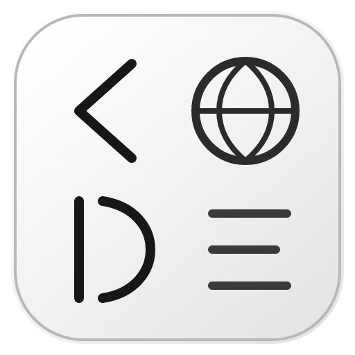

<div align="center">
  
  <h1>OpenWebCode</h1>
  <p><strong>自托管、浏览器打开即用的 AI 编码工作台</strong></p>
  <p>
    <a href="https://github.com/snnh/openwebcode/releases"></a>
    <a href="./LICENSE"></a>
    
    
  </p>
  <p>
    简体中文 | <a href="./README.en.md">English</a>
  </p>
  <p>
    <a href="#快速开始">快速开始</a> ·
    <a href="#核心功能">核心功能</a> ·
    <a href="#权限沙盒与安全边界">安全与沙盒</a> ·
    <a href="#快照与托管工作区">快照回滚</a> ·
    <a href="#headless-cli">Headless CLI</a> ·
    <a href="#文档">完整文档</a>
  </p>
</div>

OpenWebCode 是一个运行在你自己机器上的 AI 编码工作台。Agent 循环、权限决策、上下文账本、会话持久化与快照编排全部在本地服务端完成，浏览器仅负责交互——**关闭标签页或断网重连都不会中断正在执行的任务**。

它面向真实代码仓库：支持文件读写、持久终端、测试与诊断、Git 工作流、符号索引、系统级沙盒隔离与一键快照回滚；也可以在手机或另一台电脑上随时查看长任务进度并审批权限。模型接口、密钥与数据完全由你掌控，不绑定任何模型厂商。

## 为什么选择 OpenWebCode

- **服务端常驻，跨端接管**：任务跑在本地 Server，支持电脑/手机浏览器（PWA）随时接入、断线增量补拉与远程权限审批。
- **真正面向工程的隔离与回滚**：内置系统级沙盒（Windows AppContainer / Linux bubblewrap）与文件系统快照（btrfs / ZFS / overlayfs / ReFS / VHDX / qcow2 / git-shadow），敢放手让 Agent 改代码。
- **自带密钥，多协议原生接入**：原生支持 Anthropic Messages、OpenAI Chat Completions、OpenAI Responses 与 Google Gemini `generateContent`，支持运行中热切换模型、备选模型链与分角色路由。
- **精细的上下文与成本治理**：实时上下文账本、按需召回的有界工具输出、自动摘要压缩、缓存命中与 USD/CNY 成本统计。
- **轻量高性能三层架构**：C11 原生执行器 + Node.js 服务层 + React 前端，5,000 条消息长会话毫秒级响应，同时提供面向 CI/自动化的 Headless CLI（`owc run`）。

## 架构概览

```text
浏览器 web/ (React 19 + Vite 6)
        │ HTTP / WebSocket
        ▼
server/ (Node.js 24 + Fastify，默认 :3210)
        │ JSON-RPC 2.0 / stdio
        ▼
core/ (C11 可执行文件 owc-exec)
```

| 层级 | 核心职责 |
|---|---|
| **`core/`** | 纯底层执行器：命令、文件原语、PTY、路径策略、沙盒与 overlay。不实现 HTTP/LLM，不接触 API Key 和提示词。 |
| **`server/`** | Agent 循环、工具调度、权限链、上下文账本与压缩、多服务商适配、JSONL 会话持久化、快照编排、扩展宿主、MCP、SCM、索引与诊断。 |
| **`web/`** | 唯一交互界面（无 TUI），中英双语，静态产物由 server 托管。**Headless CLI**（`owc run`）复用同一套服务端 API。 |

---

## 快速开始

### Windows（x86-64）

1. 前往 [Releases](https://github.com/snnh/openwebcode/releases) 下载 `openwebcode-<version>-windows-x64.msi` 并安装（需管理员权限）。
2. 重新打开终端执行 `owc`（或运行安装目录下的 `bin\owc.cmd`）。
3. 浏览器访问 <http://127.0.0.1:3210>。

### Linux（x86-64 / arm64 / loongarch64）

一键在线安装（自动按 `uname -m` 匹配架构包）：

```sh
curl -fsSL https://raw.githubusercontent.com/snnh/openwebcode/main/packaging/install-online.sh | bash
```

也可手动下载对应架构的 `tar.gz`，解压后运行 `./install.sh`（脚本或 CI 环境可附加 `--yes` 跳过交互提问）。如需局域网访问、systemd 服务或防火墙配置，请参阅 [`packaging/README.md`](./packaging/README.md)。

### Docker（Linux 主机，amd64 / arm64）

镜像托管于 GHCR，内置 `core`、Node 24.22.1、bubblewrap、Git、Python 3 与健康检查：

```sh
# 方式一：使用仓库根目录的 docker-compose.yml（推荐）
docker compose up -d
docker compose logs | grep 访问链接
```

```sh
# 方式二：直接运行容器
docker run -d --name openwebcode --restart unless-stopped \
  -p 3210:3210 -v openwebcode-data:/data \
  ghcr.io/snnh/openwebcode:latest
docker logs openwebcode | grep 访问链接
```

容器默认监听 `0.0.0.0` 并在首次启动时自动生成访问令牌，浏览器打开日志中的 `http://<主机IP>:3210/?token=<令牌>` 即可使用。

> [!NOTE]
> - **数据与工作区**：持久化数据默认保存在 `openwebcode-data` 卷；可按需挂载宿主机代码目录至 `/workspace`（compose 中的 `OWC_WORKSPACE` 用于启动时修正顶层属主）。
> - **容器内沙盒**：默认 `bubblewrap` 需宿主机允许非特权 user namespace 及挂载权限（compose 中常见放行项为 `seccomp=unconfined`）；若宿主环境受限，请显式切换为 `landlock` 或关闭沙盒。
> - **自建镜像**：执行 `docker build -t openwebcode .` 或取消 `docker-compose.yml` 中的 `build:` 注释。

### 首次使用三步走

1. **配置模型**：打开 **设置 → 模型目录**，添加并启用任一服务商（Anthropic / OpenAI / Gemini / DeepSeek / OpenRouter / Ollama 等），拉取或手动添加模型。
2. **新建会话**：点击侧栏 **+**，选择工作目录、模型、沙盒档位与权限档位。
3. **开始协作**：在输入框描述任务并发送。建议首次先用一个小任务验证模型连通性、权限卡与沙盒行为。

---

## 支持平台

| 运行形态 | 支持架构 | 分发方式 | 默认沙盒 |
|---|---|---|---|
| **Windows 10/11** | x86-64 | MSI 安装包 | AppContainer（可切 Job Object / Windows Sandbox / 关闭） |
| **Linux** | x86-64 / arm64 / loongarch64 | `tar.gz` / 在线脚本 | bubblewrap（可切 Landlock / 关闭） |
| **Docker（Linux）** | amd64 / arm64 | `ghcr.io/snnh/openwebcode` | bubblewrap（依赖宿主能力，可切 Landlock / 关闭） |
| **浏览器** | 任意 | Chrome/Edge ≥ 111、Firefox ≥ 113（支持手机/平板） | — |

<details>
<summary>查看平台兼容性细节与最低硬件建议</summary>

- **Linux glibc**：预编译 `tar.gz` 构建于 Ubuntu 24.04，要求 **glibc ≥ 2.38**；Docker 镜像基于 Debian 13（glibc 2.41）。更低版本 glibc 请从源码自行编译。
- **内核与沙盒依赖**：Linux 默认 `bubblewrap` 缺少 `bwrap` 或非特权 user namespace 受限时会 **fail-closed** 明确报错，不会静默降级；`landlock` 需要内核 ≥ 5.13，且禁网功能需 ABI 4（约 6.7+，仅覆盖 TCP）。
- **特殊架构说明**：Windows 暂不提供 ARM64 原生包；龙芯 `loongarch64` 包不内置 Node.js，需系统预装 Node.js ≥ 24.22.1；**HarmonyOS** 版本在独立仓库开发，不在当前 Release 矩阵内。
- **硬件建议**：双核 2.0 GHz CPU、≥ 512 MiB 空闲内存（推荐 1 GiB）、≥ 500 MiB 可用磁盘；超大仓库（10 万级文件索引）或托管工作区需预留更多资源。

</details>

---

## 核心功能

### 1. 编码 Agent 与工作流

- **真实工作区操作**：内置 `bash`、`read_file`、`write_file`、`edit_file`、`glob`、`grep`、`read_media`、`read_artifact` 等工具，严格遵守工作区根边界及 no-follow/reparse 路径防护。
- **持久 Shell 与环境切换**：每会话默认复用同一个 PTY Shell（跨调用保持 `cd` 与环境变量，支持后台任务回读/终止，不可用时自动降级）；会话顶栏支持一键切换 Python（本机 / uv·工作区 / uv·配置目录）与 Node（global / project / fnm / nvm）环境，并在沙盒内按需只读挂载工具链。
- **代码索引与测试闭环**：`repo_map` / `code_search` 提供仓库结构与符号索引；`test_runner` 原生识别 vitest/jest、pytest、go test、dotnet test，并将失败诊断推送至 Problems 面板。
- **Git 与 SCM 面板**：支持 `git_status` / `git_diff` / `git_commit` 及 worktree 生命周期管理；SCM 面板支持可视化 Diff、暂存、放弃更改与自动生成 Commit Message。
- **三种运行模式 + Swarm**：
  - `code`：直接读写执行；
  - `plan`：严格只读调研并输出方案，经人工批准后才执行；
  - `goal`：每轮自评目标达成度，未完成可自动续跑（最多 10 轮）；
  - `Swarm`（独立开关，可与任一模式叠加）：多成员协作，内置共享讨论板、逐成员实时查看与可选汇总。
- **子代理、任务清单与结构化交互**：内置 `explore`（只读）、`general`（可写）及自定义子代理，隔离上下文并行派发；`todo_write` 持久化多步进度；`ask_user` 支持确认、单/多选与自由输入，暂停等待人工反馈后继续。

### 2. 模型、服务商与联网

- **四大协议原生支持**：Anthropic Messages、OpenAI Chat Completions、OpenAI Responses、Google Gemini 原生 `generateContent`（支持流式 SSE、思考配置、`thoughtSignature` / `functionCall.id` 原序回放及 `inlineData` 媒体结果）。
- **灵活调度与容错**：
  - **热切换**：运行中随时切换模型与思考档，不打断在途请求，下一轮生效；
  - **备选模型链**：最多配置 3 个备选模型，主模型遇限流/过载/超时/断流且重试耗尽后自动切换（鉴权或参数错误不切换）；
  - **角色分工**：支持独立配置快速模型（摘要压缩、标题、翻译等旁路任务）及子代理四档角色模型（极致 / 平衡 / 快速 / 廉价）。
- **Agent 预设**：支持在**经典**（默认，零侵入）、**精简**（OWC 原生精简提示词 + 工具白名单）、**拟态**（Claude Code / Kimi Code / ZCode / Codex / DSH Minimal）和**自定义**间切换（支持全局默认与会话覆盖，底层工具与权限链不变）。
- **14 种联网搜索与抓取**：`web_search` / `web_fetch` 支持 Jina、Brave、Tavily、Bing、百度 AI 搜索（千帆）、SearXNG、Exa、LinkUp、Bocha、Firecrawl、ScrapingBee、ScraperAPI、ZenRows 与 Custom，Search/Fetch 可独立配置；OpenAI Responses 另支持服务商侧内置搜索。

> [!NOTE]
> **协议差异边界**：`deferLoading` 仅在 Anthropic Messages 生效；Gemini 原生协议不映射内置 Google Search，也不使用显式 Prompt Cache 断点；服务端模型搜索仅 OpenAI Responses 支持。

### 3. 上下文治理与成本透明

- **统一上下文账本**：实时展示窗口占比、分段 Token 归因、缓存命中率，以及按 Provider/Model 统计的 USD/CNY 成本报表（支持日/会话维度与自定义定价目录）。
- **自动与手动压缩**：支持自定义触发阈值（50–100%，默认 85%），由快速模型生成经格式校验的结构化摘要（预算默认 65,536 tokens，失败自动降级为规则截断）；也可随时执行 `/compact`、`/compact tools` 或 `/clear`。
- **有界工具结果**：超长输出自动截断并落盘为 artifact 指针，Agent 可通过 `read_artifact` 按需召回，防止超大 Diff 或日志瞬间撑爆上下文。
- **官方上下文增强扩展**：开箱启用 `context-saver`（滚动驱逐、逐条 pin/排除/恢复）与 `attention-optimizer`（关键约束锚定），可选开启 `compact-vault`（压缩前完整归档，支持按 key 召回）。

### 4. 会话管理、Chat 模式与自动化

- **分支会话树**：任意消息支持编辑重发、重新生成与分叉，历史分支完整保留在 JSONL 中，随时回溯切换。
- **组织与导出**：支持手工分组、置顶、归档（释放索引与监听内存，保留历史与快照）、多选批量操作；支持导出自包含只读 HTML、Markdown 与 JSONL。
- **Chat 模式（默认关闭）**：开启后提供独立的 ChatGPT 风格界面，支持助手预设、LaTeX、图片附件、可选工具（联网/生图/Python 沙盒/文件读写）及带密码保护的只读分享链接。数据独立存于 `<数据目录>/chat-sessions/`，与工作台共享模型及联网配置，隔离会话与权限状态。
- **本机会话**：通过侧栏终端图标创建，以 Server 身份直接管理本机文件与进程（默认无沙盒，访问 HOME 外需人工批准；开启本机沙盒后写根收敛至 HOME，WSB 除外）。
- **现代工作台体验**：五区布局、命令面板、Quick Open、自定义快捷键、按需加载 Monaco 编辑器与 xterm 终端；中英双语、浅/深色主题与移动端 PWA（无离线缓存）。
- **定时任务（Cron）**：会话内通过 `cron_create` / `cron_list` / `cron_delete` 管理标准 5 字段定时任务，持久化于 `cron.json` 并在重启后恢复（停机错过的多次触发仅补一次；循环任务创建 7 天后触发末次并自动清理，单次任务触发即删）。

---

## 输入框速查

| 输入语法 | 作用说明 |
|---|---|
| 普通文本 | 向 Agent 发送任务描述（运行中发送将进入 Steering 队列，下一轮注入） |
| `/技能名` | 调用指定 Skill |
| `/自定义命令` | 触发 `.owc/commands/` 或全局命令模板 |
| `/compact` | 概览压缩当前上下文；`/compact tools` 执行规则压缩 |
| `/clear` | 清空当前模型上下文视图（**完整历史保留**，可随时回滚） |
| `/init` | 分析工作区并生成/更新根目录 `AGENTS.md`（写入走权限链） |
| `/help` | 打开 **设置 → 快捷键** |
| `@路径` | 引用工作区文件并注入消息（支持补全；大文件自动截断并留存 artifact） |
| `!命令` | Shell 快捷前缀，与 `bash` 工具共用同一套权限链和沙盒 |

> 支持草稿自动恢复、历史输入召回，以及纯图片/PDF 附件直接发送（数量、大小与模型多模态能力由前后端共同校验）。

---

## 权限、沙盒与安全边界

### 权限档位

新建会话默认使用 `review`（存量未配置会话兜底为 `ask`），支持运行中热切换并即时结算挂起的权限卡：

| 档位 | 行为策略 |
|---|---|
| **`ask`** | 所有写操作与命令逐条人工确认 |
| **`acceptEdits`** | 自动放行文件编辑，`bash` 等命令仍需人工确认 |
| **`review`**（默认） | 自动放行读操作、文件编辑与内部工具；`bash` / `test_runner` 按机器规则、审核模型、人工三档分流；MCP 与扩展工具默认人工确认 |
| **`yolo`** | 全部自动放行（切换进入前需确认风险），**但沙盒隔离依然生效** |

> [!IMPORTANT]
> 即使在 `yolo` 模式下，**`git_commit` 默认仍需人工确认**，且 **`plan` 模式的方案审批不会被跳过**。请仅对高度可信的操作配置“总是允许”规则。

### 沙盒矩阵

| 平台 | 模式 | 隔离能力与注意事项 |
|---|---|---|
| **Windows** | `appcontainer`（默认） | 真文件系统与网络隔离；支持 `allow` / `deny` / `filtered`（Sidecar 代理）；写根内缺失的 deny 路径由宿主预创建受限占位防绕过 |
| **Windows** | `jobobject` | 兼容兜底：仅限制资源，无文件/网络隔离（网络状态如实上报 partial） |
| **Windows** | `wsb` | Windows Sandbox（一会话一虚拟机），需系统开启该功能，关闭即销毁；`deny` 模式关闭 VM 网络 |
| **Linux** | `bubblewrap`（默认） | mount/net namespace 隔离；环境不满足时 fail-closed，不静默降级 |
| **Linux** | `landlock` | 显式兼容档（内核规则）；**`denyPaths` 对命令不生效**，禁网仅覆盖 TCP 且需 ABI 4 |
| **全平台** | `off` | 完全关闭沙盒（不推荐） |

*Windows 11 24H2+ 另支持 **Bind Link**，可将工作区外目录以虚拟路径映射进会话（需管理员权限，不支持 WSB）。*

### 默认安全红线

- **高危文件默认拒绝写入**：工作区内的 `.env`、`.owc/hooks.json`、`.owc/mcp.json` 默认列入 `denyPaths`，防止 Agent 通过改写凭据或宿主配置逃逸沙盒。
- **项目级可执行配置默认不信任**：`.owc/hooks.json` 与 `.owc/mcp.json` 默认关闭（`trustProjectExecConfig=false`），克隆外部仓库时请保持默认设置。
- **Git 凭据最小化挂载**：沙盒内默认仅只读挂载实际存在的 `~/.gitconfig` 及 `~/.config/git/config|ignore|attributes`；`.git-credentials`、`~/.config/gh`、`~/.ssh` 默认不挂载，需在会话中显式勾选开启。
- **远程访问鉴权**：非回环地址监听强制要求访问令牌（≥ 32 字符），支持开启 TOTP 全局登录与允许来源（Origin）白名单。OWC 自身不终止 TLS，公网或跨网段部署请套一层 HTTPS 反向代理。

> [!WARNING]
> 1. **远程终端无沙盒**：远程终端以 Server 身份直接运行在宿主机，**不经过沙盒**（需启用 TOTP 并明确配置监听地址），它与输入框 `!` 命令走完全不同的通道。
> 2. **密钥本机明文存储**：API Key 保存在 `<数据目录>/provider-profiles.json`（POSIX 权限 `0600`，前端脱敏展示）。请将整个数据目录视作敏感资产妥善保管，切勿提交至 Git 或打入公开镜像。

---

## 快照与托管工作区

默认 `auto` 模式会在每次发送用户消息前自动创建检查点（可切为 `manual`）。支持**完整回滚**（同时截断消息与还原文件）或**仅回滚文件**。

- **自动后端探测链**：Linux 按 `btrfs → ZFS → overlayfs → git-shadow` 顺序探测；Windows 按 `ReFS → git-shadow` 探测；不可用时自动提示并回落。
- **托管工作区**：支持 VHDX（Windows）与 qcow2（Linux）差分磁盘链，适合高频试错与分支实验；`overlayfs` 托管模式下源目录保持只读，改动落在 upper 层，确认后可一键“同步回源”。

| 后端 | 平台 | 实现机制 |
|---|---|---|
| `btrfs` | Linux | 子卷只读快照，恢复时替换子卷 |
| `zfs` | Linux | 数据集快照，采用复制回写恢复（不销毁较新快照） |
| `overlayfs` | Linux | 内核 overlayfs 或 fuse-overlayfs，改动累积于 upper 层，检查点为线性复制 |
| `refs` | Windows | ReFS 块克隆，失败时自动回退普通拷贝 |
| `git-shadow` | 全平台 | Git 影子仓库线性拷贝兜底（需 Git ≥ 2.25） |
| `vhdx` | Windows | 托管工作区差分链（需 Hyper-V 能力） |
| `qcow2` | Linux | 托管工作区差分链（需 `qemu-img` / `qemu-nbd` 与免密 sudo） |

<details>
<summary>查看快照与回滚边界说明</summary>

- **终端状态要求**：所有后端执行回滚前均需关闭当前会话终端；`overlayfs` 与托管镜像盘在创建检查点时同样要求关闭终端。
- **版本与上限**：`git-shadow` 依赖 `--pathspec-from-file`，要求 Git ≥ 2.25；托管 VHDX/qcow2 最多保留 32 个检查点且不支持逐个删除，达到上限需新建会话。
- **overlayfs 权限与备份**：优先使用内核 overlayfs（需 root / `CAP_SYS_ADMIN`），否则退化至 `fuse-overlayfs`；回滚前会自动复制当前 upper 层作为备份。
- **排除与保护策略**：完整回滚会保留 `denyPaths` 回退前的当前内容（回退前缺失的 deny 文件不会从旧快照“复活”）；`contextExcludes` 仅对之后新建的检查点生效。
- **不适用场景**：**本机会话**不支持快照与托管工作区。

</details>

---

## 扩展与 MCP

### 官方扩展（可在 **设置 → 扩展** 随时开关）

| 扩展名称 | 默认 | 功能说明 |
|---|---|---|
| `context-saver` | 开 | 滚动驱逐、上下文条目面板、pin/排除与 artifact 恢复 |
| `attention-optimizer` | 开 | 将关键约束锚定至上下文锚区，缓解 Lost-in-the-Middle |
| `pdf-to-image` | 开 | 将 PDF 页面转为图片附件，供多模态模型直接阅读 |
| `agent-presets` | 开 | 经典 / 精简 / 拟态 / 自定义提示词与工具形态预设 |
| `content-lens` | 关 | 不进入模型上下文的消息翻译与划词解析 |
| `compact-vault` | 关 | 压缩前归档完整上下文，支持主模型按 key 按需召回 |
| `vision-tools` | 关 | 主模型无视觉能力时，调用独立视觉模型描述图片或暴露 `describe_image` |
| `dsh-sync` | 关 | 与 dsh 数据目录双向同步模型配置与会话（仅写 `apiKeyEnv` 引用，不写明文 Key，不覆盖已有会话；暂不同步 Gemini 原生配置） |
| `owc-eval` | 关 | 任务集回放与回归评测对比 |
| `session-format-upgrade` | 关 | 离线升级旧版会话格式并清理孤儿工具调用 |

### 自定义扩展点

- **Skills**：放置于 `.owc/skills/` 或全局 `skills/<name>/SKILL.md`。
- **斜杠命令**：放置于 `.owc/commands/` 或全局 `commands/*.md`。
- **自定义子代理**：放置于 `.owc/agents/*.md`，可声明工具集与模型角色（默认只读执行，写操作由内置 `general` 经会话权限链代理）。
- **Hooks 与 MCP**：支持项目级与全局配置（项目级配置默认不信任，见安全边界）。
- **Extension Host**：第三方 `owc-ext-*` 扩展可注册工具、HTTP 路由、上下文钩子、服务商通道及 UI 面板。扩展以 Server 身份运行，安装前请自行审查源码。

> 注：dsh 兼容模式运行时已于 `v1.18.0` 下线，旧部署可使用 Release 资产中的 `purge-dsh-compat` 脚本清理残留。

---

## Headless CLI

`owc run` 通过 HTTP/WS 连接运行中的 Server，适合脚本批处理与 CI 流水线（默认新建会话，退出码：`0` 成功 / `1` Agent 错误或连接失败 / `2` 遇权限卡且未带 `--yolo`）：

```sh
owc run "给 main.ts 补充单元测试" --cwd . --json --yolo
```

| 选项 | 说明 |
|---|---|
| `--cwd DIR` | 指定工作目录（默认当前目录） |
| `--provider ID` / `--model ID` | 指定模型服务商与模型 |
| `--server URL` | 目标 Server 地址（默认 `http://127.0.0.1:3210`） |
| `--session ID` | 复用已有会话继续执行 |
| `--json` | 输出标准 NDJSON 事件流 |
| `--yolo` | 自动批准权限请求（适用于 CI） |
| `--tools LIST` / `--exclude-tools LIST` | 逗号分隔的内置工具白名单 / 黑名单 |
| `--read-only` | 仅暴露只读工具集（与 `--tools` 互斥） |
| `--fallback-models LIST` | 备选模型链（`provider/model` 逗号分隔，最多 3 个） |

- Server 开启鉴权时需设置环境变量 `OWC_ACCESS_TOKEN`；支持 `owc --help` / `owc run --help` 双语帮助。
- 从源码构建后可直接执行 `node server/dist/cli.js run ...`，无需配置 PATH。

---

## 性能基准

以下为 `v1.19.1` Release 附带的 Linux x86-64 CI 实测基准（4 vCPU / 16 GB RAM / Node 24.22.1，commit `558e725`，详见 Release 资产 `bench-results-*.json` 与 [`scripts/bench/`](./scripts/bench/)）：

| 测试场景 | 核心指标 |
|---|---|
| **5,000 消息长会话** | `load.p50` **0.45 ms** · 冷加载 **54 ms** · 分页 **0.43 ms** |
| **上下文构建（5,000 消息）** | 增量构建 **0.99 ms** vs 全量 13.99 ms（**14.1×** 加速，命中率 1.0） |
| **浏览器渲染（5,000 消息）** | 滚动 p50 **59.88 fps** · 首屏 **64 ms** · 输入回显 **31.4 ms** · 堆 **37.94 MiB**（滚动增长 0.26%） |
| **多工具并发事件** | **8,146 events/s**（p50） · 延迟 p95 **2 ms** |
| **10 万文件仓库索引** | 冷加载 **340.6 ms** · 堆增量 **+151.5 MiB** · 查询 p95 **25.3 ms** |
| **慢 WS 客户端隔离** | 断连耗时 **2.47 ms** · 正常客户端吞吐 **17.29 MiB/s** |

*注：本地内存长跑参考（`v1.18.0`，非 CI 门禁，5,000 消息/会话）：单长会话 RSS 约 82.9 MiB；16 个并发长会话约 86 MiB 堆 / 242 MiB RSS（不同硬件与会话内容会有显著波动，仅作趋势参考）。*

---

## 数据、配置、备份与升级

### 目录解析与常用环境变量

- **默认路径**：显式环境变量 `OWC_DATA_DIR` 优先；否则由启动器注入默认值——Windows 为 `%USERPROFILE%\openwebcode`，Linux 为 `${XDG_DATA_HOME:-~/.local/share}/openwebcode`，Docker 为 `/data`（直接执行 `node server/dist/index.js` 时回退至 `server` 同级的 `.openwebcode`）。
- **业务数据拆分**：可在设置页修改 `dataDir` 将业务数据迁移至他处（下次启动生效，`server-settings.json` 仍留在启动/设置目录）。
- **常用环境变量**：`OWC_HOST`、`OWC_PORT`、`OWC_ACCESS_TOKEN`、`OWC_CORE_PATH`、`OWC_BROWSE_ROOTS`、`OWC_OFFLINE`、`OWC_SANDBOX_MODE`、`OWC_SNAPSHOT_BACKEND`（完整列表见 [`help/usage.md`](./help/usage.md)）。
- **代理与离线模式**：出站 HTTP 支持关闭 / 跟随环境变量 / 自定义 HTTP(S) 代理（不支持 SOCKS）；离线模式仅停用 Server 自身的启动与周期性出站请求（更新检查、目录同步、汇率刷新），不影响模型 API、联网工具及 MCP 请求。

<details>
<summary>查看关键数据文件路径清单</summary>

| 路径 | 用途 |
|---|---|
| `<启动/设置目录>/server-settings.json` | 服务端核心设置 |
| `<数据目录>/provider-profiles.json` | 模型/联网服务商配置与密钥（本机明文，POSIX `0600`） |
| `<数据目录>/access-token` | 非回环监听自动生成的访问令牌（POSIX `0600`） |
| `<数据目录>/totp.json` | TOTP 登录凭据与恢复码哈希（POSIX `0600`） |
| `<数据目录>/sessions/<id>/` | 工作台会话数据（`meta.json`、`messages.jsonl`、`ledger.json`、`todos.json`、`artifacts/`） |
| `<数据目录>/chat-sessions/` | 独立 Chat 模式会话 |
| `<数据目录>/chat.json` / `chat-assistants.json` | Chat 全局设置与助手预设 |
| `<数据目录>/cron.json` | 全部定时任务持久化 |
| `<数据目录>/mcp.json` / `hooks.json` | 全局 MCP 与 Hooks 配置 |
| `<数据目录>/extensions/` | Extension Host 配置与第三方扩展 |
| `<数据目录>/system-prompt*.md` | 全局系统提示词覆盖、追加与子代理指令 |
| `<数据目录>/logs/` | 运行日志（含 `core` stderr） |
| `<项目>/.owc/` | 项目级 skills、commands、agents、hooks、MCP、memory 与提示词覆盖 |

</details>

### 备份与升级

- **备份建议**：停止 Server 后完整复制业务数据目录；工作区源码在外部目录，请一并备份（托管工作区同时依赖数据目录内的镜像/overlay 状态与原始工作区）。
- **升级方式**：Windows 覆盖安装新 MSI；Linux 重跑安装脚本；Docker 执行 `docker compose pull && docker compose up -d`。所有升级均保留现有数据目录。
- **在线更新**：更新检查默认关闭，开启后可在 **设置 → 服务信息** 一键更新（自动 SHA256 校验后替换安装目录；Docker 镜像不支持原地自更新）。

---

## 从源码构建与目录结构

**构建前置**：Node.js ≥ 24.22.1、CMake ≥ 3.19、C11 编译器、Python 3（`core` 协议测试）、Git ≥ 2.25（拉取 `@snnh/llm-api` 依赖）；Linux 完整沙盒测试需安装 `bubblewrap`。

<details>
<summary>展开三层独立构建与本地联调命令</summary>

仓库根目录无 `package.json`，三层独立构建与校验：

```sh
# 1. core（C11 执行器）
cmake -S core -B build
cmake --build build --config Debug
ctest --test-dir build -C Debug --output-on-failure

# 2. server（Node 服务层）
cd server && npm ci && npm run build
npm test && npm run lint && npx knip && npm run contracts-check

# 3. web（React 前端，含 tsc -b、预压缩与体积预算检查）
cd ../web && npm ci && npm run build
npm test && npm run lint && npx knip
```

**本地三层联调**（开启三个终端）：

```sh
# 终端 1：构建 core
cmake -S core -B build && cmake --build build --config Debug

# 终端 2：启动 server（Windows 请指定 ..\build\Debug\owc-exec.exe）
cd server && OWC_CORE_PATH=../build/owc-exec npm run dev

# 终端 3：启动 web（Vite :5173，自动代理 /api 至 127.0.0.1:3210）
cd web && npm run dev
```

*开发约定：`@snnh/llm-api` 锁定至公开仓库 Git commit，离线环境需提前准备依赖；发版须保持 `core/CMakeLists.txt`、`server/package.json`、`web/package.json`、Release Tag 与 `CHANGELOG.md` 版本一致。*

</details>

| 目录 | 职责 |
|---|---|
| `core/` | C11 执行器：stdio JSON-RPC、命令/文件/PTY、路径策略与各平台沙盒原语 |
| `server/` | Agent 循环、多服务商、上下文账本、会话、权限、快照、扩展宿主、MCP、SCM、索引与诊断 |
| `web/` | React 19 + Vite 6 前端，Monaco / xterm / KaTeX / Shiki 按需加载 |
| `packaging/` | MSI / `tar.gz` 打包布局、安装器、systemd 与发布脚本 |
| `scripts/bench/` | 可复现性能基准与 Release 门禁脚本 |
| `help/` | 使用指南、FAQ、二次开发与 `dsh-sync` 文档 |
| `attic/` | 已下线代码归档（不参与构建、测试、lint 与发布） |

---

## 文档

- [`help/usage.md`](./help/usage.md) — 使用指南：启动配置、面板快捷键、模型成本、上下文与扩展模板
- [`help/faq.md`](./help/faq.md) — 常见问题：模型接入、权限与沙盒排错、快照回滚与 CLI 集成
- [`help/dsh-sync.md`](./help/dsh-sync.md) — dsh 同步扩展说明（[English](./help/dsh-sync.en.md)）
- [`help/development.md`](./help/development.md) — 二次开发：架构切入点、测试规范、CI 与发布流程
- [`packaging/README.md`](./packaging/README.md) — 打包流水线、分发布局与系统服务配置
- [`CHANGELOG.md`](./CHANGELOG.md) — 版本更新日志

## 卸载

- **Windows**：在「设置 → 应用」中直接卸载。
- **Linux**：运行 `<prefix>/bin/owc-uninstall`（自动停止并移除 systemd 服务、运行时与启动器；数据目录默认保留，如需清理请加 `--purge-data`，清理防火墙规则需 root 下加 `--remove-firewall`）。
- **Docker**：执行 `docker compose down`；如需彻底清除数据，再删除 `openwebcode-data` 卷。

## 赞助

OpenWebCode 是个人维护的开源项目。如果它为你节省了时间，欢迎通过 [donate.md](./donate.md) 支持持续开发：


## 特别感谢

- 感谢 **DeepSeek、Kimi-K3、Qwen** 在本项目开发过程中的辅助。
- 感谢社区群友提供的宝贵灵感与反馈。
- 感谢 [pi-agent](https://github.com/earendil-works/pi)（MIT，Mario Zechner），本项目默认系统提示词以其为基线。
- 感谢 [@Shyliuli](https://github.com/Shyliuli) 协助完成龙芯（loongarch64）版本适配与测试。

## License

本项目基于 [Apache-2.0](./LICENSE) 协议开源。
